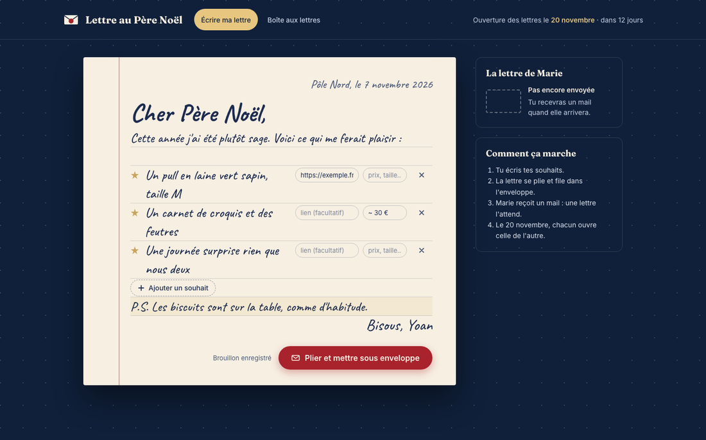
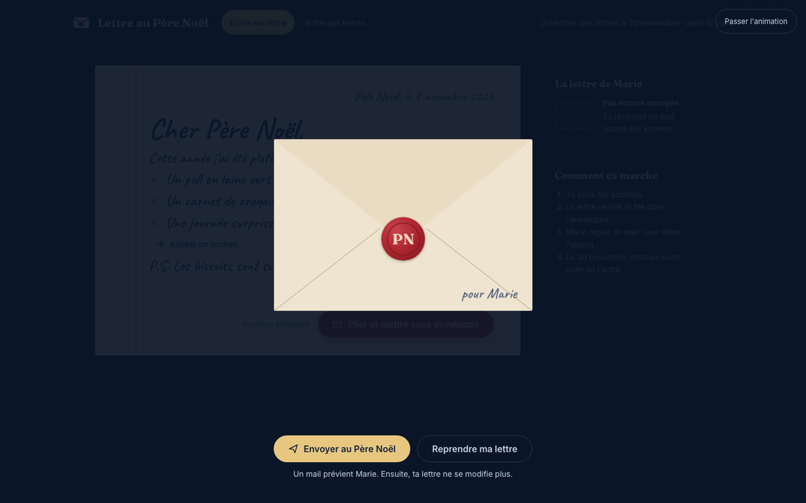
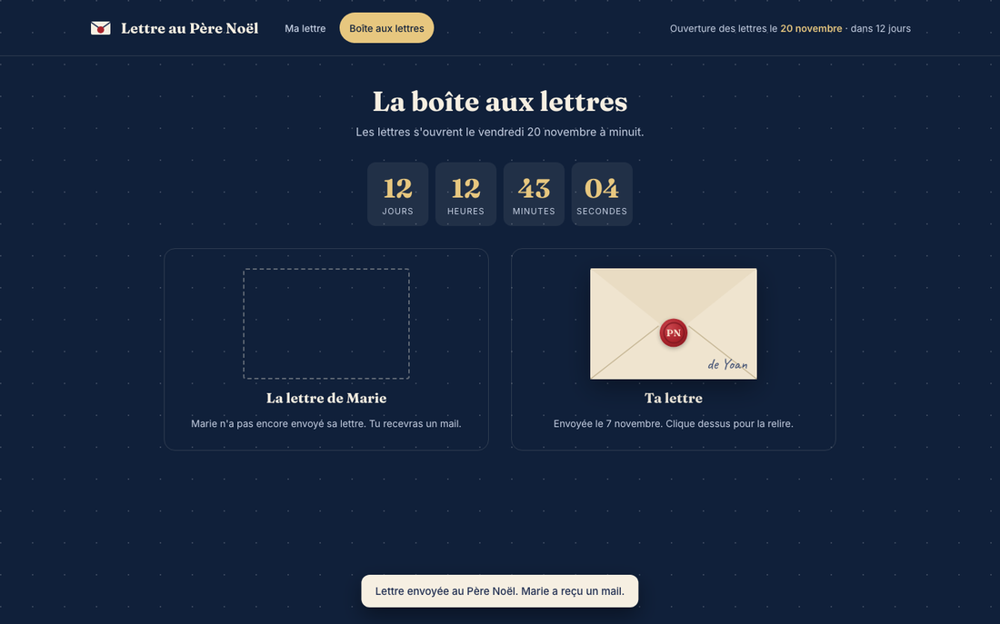
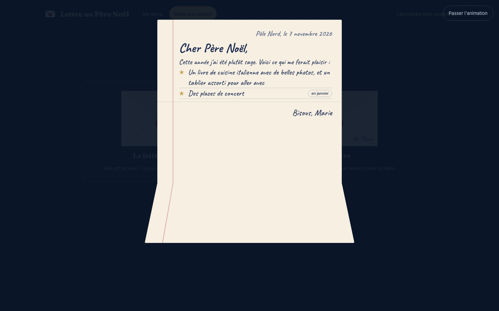
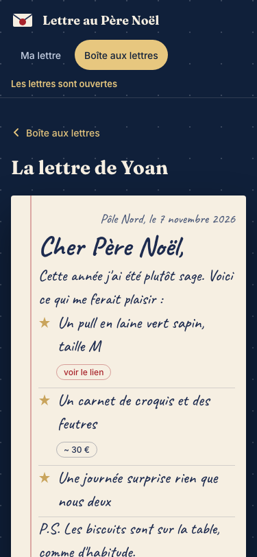
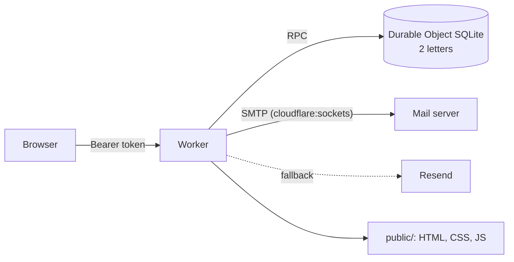

<div align="center">

[](README.md)


# Lettre au Père Noël

**Two Christmas wishlists, swapped like real letters to Santa.**<br>
Each person writes theirs, folds it, seals it and sends it. Both stay sealed until reveal day, then open with an animation.

[](LICENSE)
[](https://developers.cloudflare.com/workers/)
[](https://developers.cloudflare.com/durable-objects/)
[](public)
[](AGENTS.md)

</div>

<p align="center"></p>

The interface is in French.

## How it works

1. Each person gets a **personal link** and writes their letter to Santa: a list of wishes, each with an optional link or note (price, size).
2. **Fold into the envelope**: the letter folds in three, slides into the envelope, and the wax seal drops. It can still be taken back.
3. **Send to Santa**: the envelope flies away, the letter is sealed for good, and the other person gets an email.
4. Until reveal day, the other letter stays sealed. Clicking it only makes it shake. Its content never even leaves the server.
5. On reveal day, click the envelope: the seal breaks, the flap opens, and the letter slides out and unfolds.

<table>
<tr>
<td></td>
<td></td>
</tr>
<tr>
<td></td>
<td align="center"></td>
</tr>
</table>

## Install

You need a Cloudflare account (the free plan is enough), Node 20 or later, and a domain on Cloudflare for the site address.

```sh
git clone https://github.com/pyxl-dev/lettre-pere-noel && cd lettre-pere-noel && npm install
```

### 1. Configure

In [`wrangler.jsonc`](wrangler.jsonc), set:

| Variable | Purpose | Default |
| --- | --- | --- |
| `REVEAL_AT` | reveal date and time (ISO 8601 with offset) | `2026-11-20T00:00:00+01:00` |
| `PUBLIC_URL` | site address, used in the email | `https://noel.nizrod.ovh` |
| `MAIL_FROM` | email sender | `noel@yoanancelly.fr` |
| `SMTP_HOST`, `SMTP_PORT` | SMTP server (465: implicit TLS, 587: STARTTLS) | `bain.o2switch.net`, `465` |
| `routes` | Worker custom domain | `noel.nizrod.ovh` |

### 2. Secrets

Generate both tokens and their links:

```sh
npm run tokens -- https://your-domain.example
```

Then store each secret (Wrangler prompts for the value):

```sh
for s in PERSON_A_NAME PERSON_A_EMAIL PERSON_A_TOKEN PERSON_B_NAME PERSON_B_EMAIL PERSON_B_TOKEN SMTP_USER SMTP_PASS; do npx wrangler secret put "$s"; done
```

`RESEND_API_KEY` is optional: if SMTP fails, the email goes through [Resend](https://resend.com). Names and addresses stay secrets: nothing personal lives in the repository.

### 3. Deploy

```sh
npm run deploy
```

Send each person **their own** link (`https://…/#t=<token>`). The token sits in the URL fragment, so it never reaches server logs, and the browser remembers it afterwards.

## Develop

```sh
cp .dev.vars.example .dev.vars
npm run sink   # local fake SMTP server on 127.0.0.1:2526: emails land in .smtp-sink/
npm run dev    # http://127.0.0.1:8786/#t=jeton-dev-personne-a-0001
```

To see the letters opened right away: `npx wrangler dev --var REVEAL_AT:2026-01-01T00:00:00+01:00`.

| Command | What it checks |
| --- | --- |
| `npm test` | business rules (tokens, reveal date, letter cleaning, links) and the SMTP client against the fake server |
| `npm run e2e` | the full journey in a headless browser, desktop and mobile, with screenshots in `.pilote-shots/` |

The e2e test drives Chromium with [Playwright](https://playwright.dev) (`npx playwright install chromium` the first time). It starts its own Worker and fake SMTP server on separate ports: it touches neither the `npm run dev` state nor the Internet.

## Under the hood



- [`src/worker.js`](src/worker.js): API (`GET /api/state`, `PUT /api/letter`, `POST /api/send`), security headers, `LettersStore` Durable Object.
- [`src/logic.js`](src/logic.js): pure rules, tested under Node.
- [`src/smtp.js`](src/smtp.js): minimal SMTP client on `cloudflare:sockets`, no dependency.
- [`public/`](public): the app, in plain HTML, CSS and JavaScript. The animations (3D fold, envelope, seal) use CSS transforms and the Web Animations API, and honour `prefers-reduced-motion`.

Guarantees enforced by the server, not the UI: a sent letter can no longer change (409), the other letter is only returned after `REVEAL_AT`, wish links are limited to `http(s)`.

## Licence

[MIT](LICENSE)
