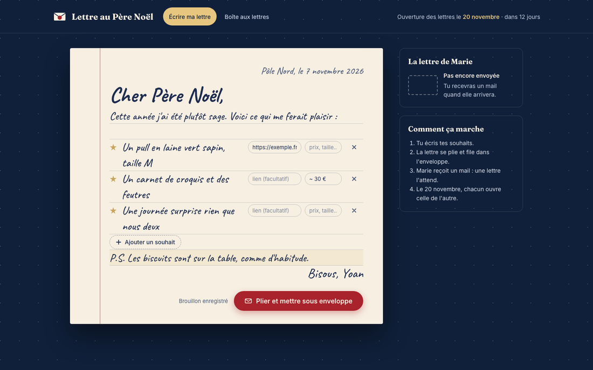
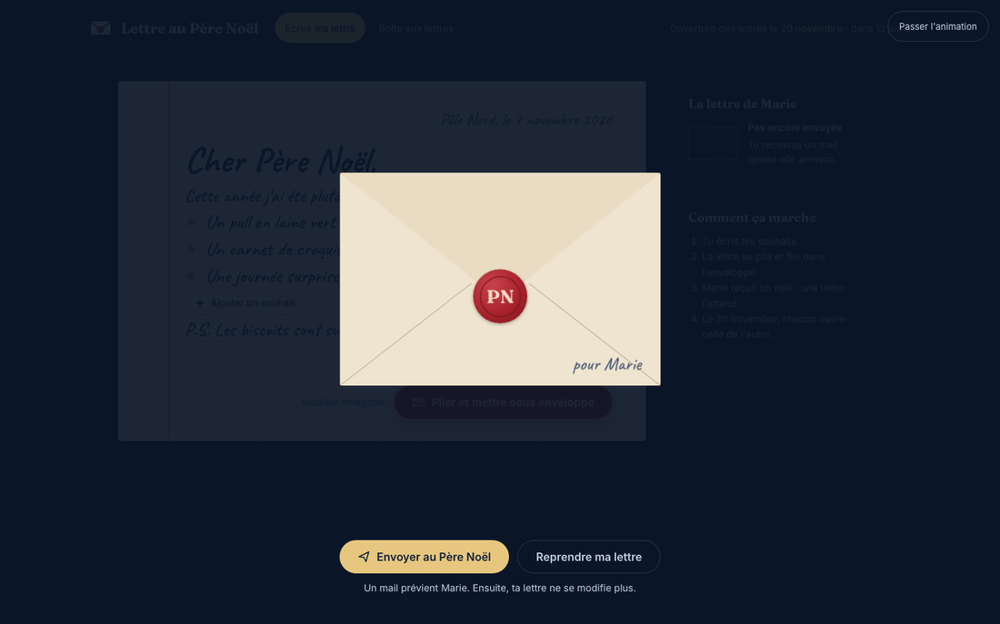
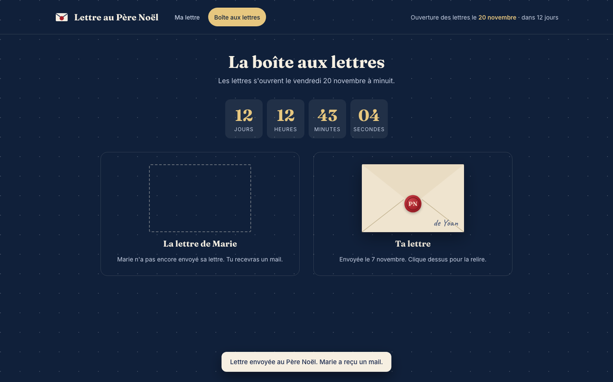
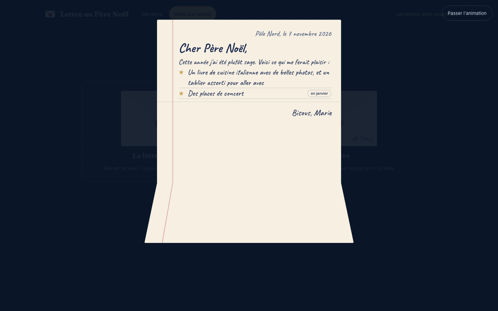
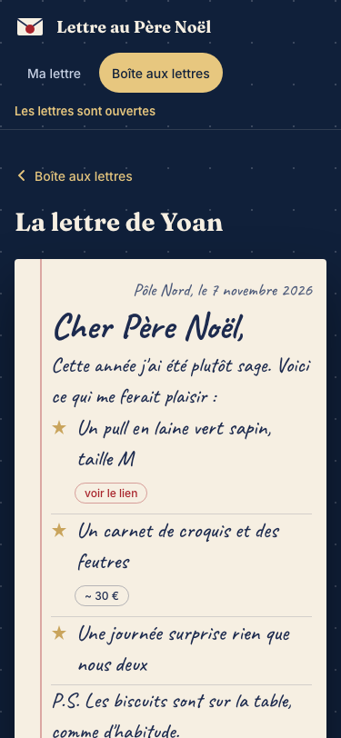
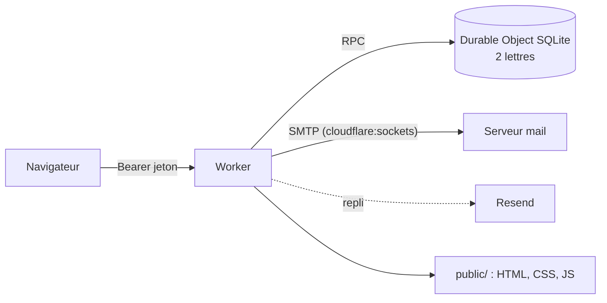

<div align="center">

[](README.en.md)


# Lettre au Père Noël

**Deux wishlists de Noël échangées comme de vraies lettres.**<br>
Chacun écrit la sienne, la plie, la scelle et l'envoie. Elles restent fermées jusqu'au jour J, puis s'ouvrent avec une animation.

[](LICENSE)
[](https://developers.cloudflare.com/workers/)
[](https://developers.cloudflare.com/durable-objects/)
[](public)
[](AGENTS.md)

</div>

<p align="center"></p>

## Le principe

1. Chacun reçoit un **lien personnel** et écrit sa lettre au Père Noël : une liste de souhaits, avec un lien ou une précision (prix, taille) si besoin.
2. **Plier et mettre sous enveloppe** : la lettre se plie en trois, glisse dans l'enveloppe, le cachet de cire tombe. On peut encore la reprendre.
3. **Envoyer au Père Noël** : l'enveloppe s'envole, la lettre est scellée pour de bon, et l'autre personne reçoit un mail.
4. Jusqu'à la date d'ouverture, la lettre de l'autre reste fermée. Un clic la fait juste trembler. Son contenu ne quitte même pas le serveur.
5. Le jour J, on clique sur l'enveloppe : le cachet se brise, le rabat s'ouvre, la lettre sort et se déplie.

<table>
<tr>
<td></td>
<td></td>
</tr>
<tr>
<td></td>
<td align="center"></td>
</tr>
</table>

## Installer

Il faut un compte Cloudflare (offre gratuite suffisante), Node 20 ou plus, et un domaine géré par Cloudflare pour l'adresse du site.

```sh
git clone https://github.com/pyxl-dev/lettre-pere-noel && cd lettre-pere-noel && npm install
```

### 1. Configurer

Dans [`wrangler.jsonc`](wrangler.jsonc), adapte :

| Variable | Rôle | Valeur par défaut |
| --- | --- | --- |
| `REVEAL_AT` | date et heure d'ouverture (ISO 8601 avec fuseau) | `2026-11-20T00:00:00+01:00` |
| `PUBLIC_URL` | adresse du site, utilisée dans le mail | `https://noel.nizrod.ovh` |
| `MAIL_FROM` | expéditeur du mail | `noel@yoanancelly.fr` |
| `SMTP_HOST`, `SMTP_PORT` | serveur SMTP (465 : TLS direct, 587 : STARTTLS) | `bain.o2switch.net`, `465` |
| `routes` | domaine personnalisé du Worker | `noel.nizrod.ovh` |

### 2. Les secrets

Génère les deux jetons et leurs liens :

```sh
npm run tokens -- https://ton-domaine.example
```

Puis enregistre chaque secret (Wrangler demande la valeur) :

```sh
for s in PERSON_A_NAME PERSON_A_EMAIL PERSON_A_TOKEN PERSON_B_NAME PERSON_B_EMAIL PERSON_B_TOKEN SMTP_USER SMTP_PASS; do npx wrangler secret put "$s"; done
```

`RESEND_API_KEY` est facultatif : si l'envoi SMTP échoue, le mail part par [Resend](https://resend.com). Les noms et adresses restent des secrets : rien de personnel n'est dans le dépôt.

### 3. Déployer

```sh
npm run deploy
```

Envoie à chaque personne **son** lien (`https://…/#t=<jeton>`). Le jeton est dans le fragment de l'adresse : il n'apparaît pas dans les journaux du serveur, et le navigateur s'en souvient ensuite.

## Développer

```sh
cp .dev.vars.example .dev.vars
npm run sink   # faux serveur SMTP local sur 127.0.0.1:2526 : les mails arrivent dans .smtp-sink/
npm run dev    # http://127.0.0.1:8786/#t=jeton-dev-personne-a-0001
```

Pour voir les lettres ouvertes sans attendre : `npx wrangler dev --var REVEAL_AT:2026-01-01T00:00:00+01:00`.

| Commande | Ce qu'elle vérifie |
| --- | --- |
| `npm test` | règles métier (jetons, date d'ouverture, nettoyage des lettres, liens) et client SMTP contre le faux serveur |
| `npm run e2e` | parcours complet en navigateur headless, desktop et mobile, avec captures dans `.pilote-shots/` |

Le test e2e pilote Chromium avec [Playwright](https://playwright.dev) (`npx playwright install chromium` la première fois). Il démarre son propre Worker et son propre faux SMTP, sur des ports à part : il ne touche ni à l'état de `npm run dev`, ni à Internet.

## Comment c'est fait



- [`src/worker.js`](src/worker.js) : API (`GET /api/state`, `PUT /api/letter`, `POST /api/send`), en-têtes de sécurité, Durable Object `LettersStore`.
- [`src/logic.js`](src/logic.js) : règles pures, testées sous Node.
- [`src/smtp.js`](src/smtp.js) : client SMTP minimal sur `cloudflare:sockets`, sans dépendance.
- [`public/`](public) : l'application, en HTML, CSS et JavaScript sans framework. Les animations (pliage 3D, enveloppe, cachet) utilisent les transformations CSS et la Web Animations API, et respectent `prefers-reduced-motion`.

Garanties tenues par le serveur, pas par l'interface : une lettre envoyée ne se modifie plus (409), la lettre de l'autre n'est renvoyée qu'après `REVEAL_AT`, les liens des souhaits sont limités à `http(s)`.

## Licence

[MIT](LICENSE)
